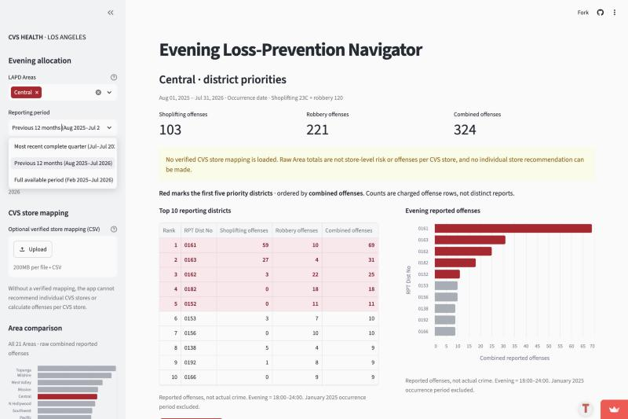
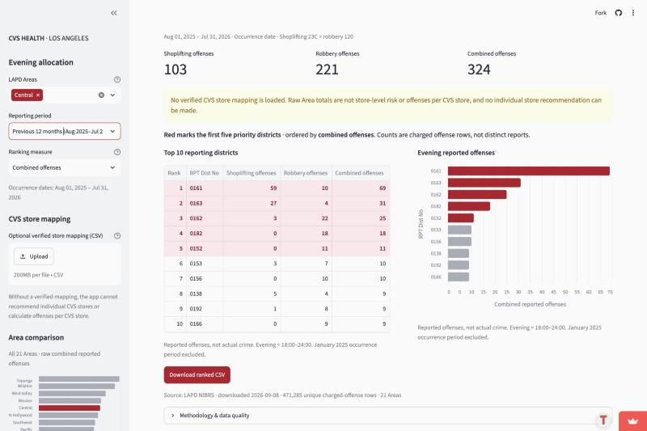
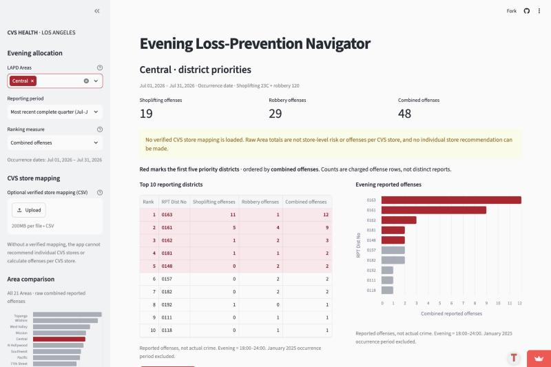

# Case: Elena Ruiz — Should a downtown CVS close at 10 p.m. instead of midnight?

> **Individual. Hand in one PDF file**, not this Markdown file: one case for **your team's
> app**, one specific person using it for one real decision, with screenshots of your team's
> **live app**. Five parts: **1** the person and the decision; **2** their real situation and their
> alternatives, from at least two sources; **3** the app in use, with live-app screenshots; **4**
> reading the result for their decision; **5** the verdict: prove the app is as good as it gets
> for this person, or break it with a change request.

*Author: Amy (Yutong Wu), team M1 · November 2026 · a difficult case: a user at the edge of what the app is for.*

## 1. The person and the decision

> **Enough:** a specific person and one decision your app is for, so that a reader who has never
> seen your project can picture it.

Elena Ruiz (fictional) is a CVS **District Leader** — a retail-operations manager, not a security manager — responsible for a group of stores in downtown Los Angeles. One of them, whose address she has verified falls in LAPD **Central Area, reporting district 0161**, currently stays open until midnight. At her quarterly store-hours review she must decide whether to recommend closing that store at **10:00 p.m. instead of midnight**, because staff have raised safety concerns about the last hours of the night. If she closes early without reason, she loses late-night sales and customers who rely on a store being open; if she keeps it open when the last two hours really are dangerous, she exposes staff to robbery risk.

Unlike the other cases on our team (Ana's citywide guard budget, Maya's Topanga district shortlist, Rita's single-store guard request, Jordan's supervisor-visit route), Elena does not decide anything about guards. Her question is about **when** in the evening the risk sits, not **where**.

## 2. Their real situation and alternatives

> **Enough:** how this kind of person makes this decision today, what they are trying to
> achieve and what matters to them, and the alternatives they have to your app, from at least
> two sources you read.

A CVS District Leader is responsible for overall store operations in a district, including P&L, payroll and the asset-protection and shrink budget, and for making sure store staffing plans are considered at district level (Source 1). So Elena weighs late-night sales against the payroll and safety cost of keeping two more hours staffed. CVS says it periodically reviews operating hours to make sure stores are open during peak customer demand (Source 2), so an hours review is a routine decision for her, not a crisis. Retailers have also cut hours specifically because of theft and security incidents: in 2021 Target moved six San Francisco stores from a 10 p.m. to a 6 p.m. close, and Walgreens and CVS locations in the area also changed hours or closed (Source 3). What matters to Elena that our app's data do **not** contain: her store's late-night sales and customer counts, its own incident log after 10 p.m., how many staff are on shift, and whether nearby stores are still open after 10 p.m.

Her alternatives today are (a) her store's internal incident and sales data by hour, (b) asking the store manager and staff, (c) asking CVS asset protection, and (d) filtering the City of Los Angeles LAPD NIBRS offense data herself by district and hour (Source 4), which is slow in a spreadsheet but can split any hour. Part 5 compares the app with these.

**Sources:**

1. CVS Health, *District Leader, FS* (job listing, Sacramento, CA): https://jobs.haceonline.org/job/district-leader-fs/85053997/
2. CBS News Boston, *CVS cutting down, adjusting pharmacy hours in two-thirds of stores* (Jan 27, 2023): https://www.cbsnews.com/boston/news/cvs-cutting-down-adjusting-pharmacy-hours-stores
3. Scripps / WMAR-2 News, *San Francisco stores changing hours after 'alarming' rise in thefts, security incidents* (2021): https://www.wmar2news.com/news/national/san-francisco-stores-changing-hours-after-alarming-rise-in-thefts-security-incidents
4. City of Los Angeles / LAPD, *LAPD NIBRS Offenses Dataset*: https://data.lacity.org/Public-Safety/LAPD-NIBRS-Offenses-Dataset-2026-to-Present/k7nn-b2ep

## 3. The app in use

> **Enough:** your team's live link, what the person selects, at least one screenshot **of the
> live app** with the selections visible, and what they see, in your own words.

**Live link:** https://dso576-project-m1.streamlit.app/ (all screenshots taken from this link on Nov 8, 2026).

**Screen 1 — choosing the period.** Elena selects **LAPD Areas = Central** and opens **Reporting period**. Because her review is quarterly she first looks at *Most recent complete quarter*, but its label reads "(Jul–Jul 2026)". She chooses **Previous 12 months (Aug 2025–Jul 2026)** instead, so one summer is not over-weighted.



**Screen 2 — the result.** Selections: Central · Previous 12 months · Ranking measure **Combined offenses** · no store mapping uploaded.



**What Elena sees:** Central has 103 shoplifting, 221 robbery and **324 combined** evening offenses. Her own district, **0161, is ranked #1 and highlighted in red**: 59 shoplifting + 10 robbery = **69 combined**, more than twice district 0163 (31). The chart shows 0161 with by far the longest bar. Every caption defines "Evening = 18:00–24:00", and the yellow warning says no CVS store mapping is loaded. Nothing on the page tells her how many of those 69 happened **after 10 p.m.**, the only hours her decision changes.

**Screen 3 — what "Most recent complete quarter" actually covers.** Selecting it shows occurrence dates **Jul 01, 2026 – Jul 31, 2026**: one month, not a quarter.



## 4. Reading the result for their decision

> **Enough:** an answer to each question below, each backed by evidence: a number from the
> data, a rule, a source, or a check you ran.

**Does the number measure what this person cares about?** No — this is a *which rows belong* problem (handout 11.5, kind 2). The app's evening window is fixed in `src/filter.py` as `EVENING_START = '1800'`, `EVENING_END = '2359'`, so the 69 counts everything from 6 p.m. to midnight. Elena's decision only changes **10 p.m.–midnight**; 6–10 p.m. stays open either way. When I split the app's own rows (check below), district 0161 has **69 offenses from 18:00–21:59 and 0 from 22:00–23:59**. The red #1 rank is driven entirely by early-evening shoplifting (59 rows), which her decision does not touch. Across all of Central, only 81 of the 324 rows (25%) are after 10 p.m., and 79 of those 81 are robbery.

**Who is in the rows, and who is not?** The rows are LAPD-reported **charged offense rows** (not distinct reports) coded shoplifting 23C or robbery 120, occurring Aug 1, 2025 – Jul 31, 2026, 18:00–23:59, in Central. They include street robberies that have nothing to do with a store, and they exclude unreported incidents and incidents CVS handled without police. Importantly, **a shoplifting can only be recorded where a store is open**: if most stores in 0161 close by 10 p.m., zero late shoplifting may mean "no open stores", not "safe". The rows cannot say what would happen to *her* store's staff after 10 p.m.

**What outside the data matters to this decision?** Her store's sales and customer count by hour after 10 p.m., its own after-10 p.m. incident log, staffing level on the late shift, whether other stores nearby stay open, and CVS's own hours policy (Source 2). These decide the trade-off; the app can at most supply the police-data context for the 10 p.m.–midnight hours.

**What could they wrongly conclude from it?** Seeing 0161 ranked #1 in red with 69 "evening" offenses, Elena could conclude that her store's late night is the most dangerous in Central and recommend a 10 p.m. close — when the police data show **no** robbery or shoplifting in 0161 after 10 p.m. in the whole year. A second trap: she could pick "Most recent complete quarter" and believe she is looking at three months, when it is only July 2026 (kind 5, *which dates belong*).

**Check run** — I re-used the app's own filter and ranking functions on the team's committed snapshot (`data/processed/offenses.parquet`) and split the same rows at 22:00. Code in `check_late_evening.py` (run from the team repo with `PYTHONPATH=.`):

```python
rows = filter_offenses(offenses, 'Central', date(2025, 8, 1), date(2026, 7, 31))  # app's rows
rows['window'] = rows['Time OCC'].str[:2].astype(int).map(
    lambda h: '22:00-23:59' if h >= 22 else '18:00-21:59')
split = rows.groupby(['RPT Dist No', 'window', 'NIBR Code']).size().unstack(['window', 'NIBR Code'], fill_value=0)
```

```text
Rows the app counts for Central: 324          (matches the live app: 103 + 221 = 324)
 rank RPT Dist No  shoplifting  robbery  combined     (matches Screen 2)
    1        0161           59       10        69
    2        0163           27        4        31
    3        0162            3       22        25
    4        0182            0       18        18
    5        0152            0       11        11

Top 5 districts split by part of the evening:
District  18-22 robbery  22-24 robbery  18-22 shoplift  22-24 shoplift  app combined  late (22-24)
0161             10             0             59              0             69             0
0163              4             0             27              0             31             0
0162             14             8              3              0             25             8
0182             14             4              0              0             18             4
0152             10             1              0              0             11             1

Central total by window:  18:00-21:59 = 243   22:00-23:59 = 81

Could it be luck? District 0161 by half-year:
              18:00-21:59   22:00-23:59
Aug25-Jan26        24             0
Feb26-Jul26        45             0
```

The app's displayed numbers match the recomputation exactly, so the app is counting correctly; the problem is the question it answers. The late-evening finding holds in both halves of the year. The counts are small (8 or fewer late rows per district), so the late ranking is a rough signal only — but "0 of 69" in her own district is not a small-sample artefact of the kind that would flip her decision. Over the full available period (Feb 2025 – Jul 2026) district 0161 still has only 2 rows after 22:00 (1 shoplifting, 1 robbery).

## 5. The verdict: prove or break

> **Enough:** whether this person is better off with the app than with the alternatives in
> part 2, the app's place among them, and what they must not use it for. Then **either**
> compelling evidence that, for this person, the app is as good as it gets with the data
> available, **or** a change request that makes it better for this case without being made
> only for this case or making other users' answers worse.

**As it stands, Elena is not better off with the app than with her alternatives** — she is at risk of being misled. Its headline (0161 = #1 evening priority) points toward closing early, while the same rows, split at 10 p.m., point the other way. Her store's own hourly incident log and sales, and a conversation with the store manager, answer her question more directly; filtering the public LAPD data herself would at least let her pick 22:00–24:00. The app must **not** be used to decide store hours, to judge risk in any part of the evening narrower than 18:00–24:00, or to claim a store is safe because late counts are low (stores that are closed cannot be shoplifted).

The data can answer her question — the hour is already in every row — so this is **broken, and fixable**. With the change below, the app would give her a fast, citywide-consistent late-evening view of police data that she cannot get from her own store's log, and its place would be one input next to her internal data.

```markdown
### CR-12: Show early-evening and late-evening offenses separately

- **From:** Amy (Yutong Wu), Elena Ruiz store-hours case, 2026-11-08
- **Part:** Top-10 district table, chart and CSV export; filter window in src/filter.py
- **Evidence:** Central, Previous 12 months, Combined offenses: district 0161 ranks #1 with 69
  offenses, but splitting the same rows at 22:00 gives 69 from 18:00–21:59 and 0 from
  22:00–23:59 (Aug25–Jan26: 24/0; Feb26–Jul26: 45/0). Citywide (same 12 months),
  22:00–23:59 holds 656 robbery but only 134 shoplifting rows, so the late hours have a different mix from the early ones.
  A user deciding anything about the last hours of the night is shown a number driven by hours
  their decision does not change.
- **Change:** Add a sidebar control "Part of evening" with options 18:00–24:00 (default,
  unchanged), 18:00–22:00 and 22:00–24:00, applied to the metrics, ranking, chart and export
  (export records the window used). Also add two columns to the table, "of which 22:00–24:00",
  so the split is visible even at the default.
- **Who else it affects:** Ana, Maya, Rita and Jordan keep the identical default ranking and
  numbers; guard-shift planners gain the option to see whether a second guard is needed for the
  whole shift or only the last hours.
- **Why it does not hurt them:** The default window, ranking and caption are unchanged; the new
  columns only add information. Small late counts should carry the existing "charged offense
  rows" caption plus a note that late shoplifting depends on which stores are open.
- **Priority:** medium
- **Status:** open

### CR-13: Make "Most recent complete quarter" an actual quarter, or relabel it

- **From:** Amy (Yutong Wu), Elena Ruiz store-hours case, 2026-11-08
- **Part:** Reporting period options, src/view.py `period_options`
- **Evidence:** The live app labels the option "Most recent complete quarter (Jul–Jul 2026)" and
  its caption shows Jul 01, 2026 – Jul 31, 2026: one month. The code sets the start to the
  first month of the calendar quarter that contains the snapshot's end month (July), so it
  covers July only.
- **Change:** Use the last fully covered calendar quarter (Apr 1 – Jun 30, 2026) or the last
  three complete months (May 1 – Jul 31, 2026), and show the exact dates in the label.
- **Who else it affects:** Every user who picks this option, including the Topanga case, which
  reads this option as three months.
- **Why it does not hurt them:** The other two periods are unchanged; the quarter users get the
  period the label promises.
- **Priority:** high
- **Status:** open
```
